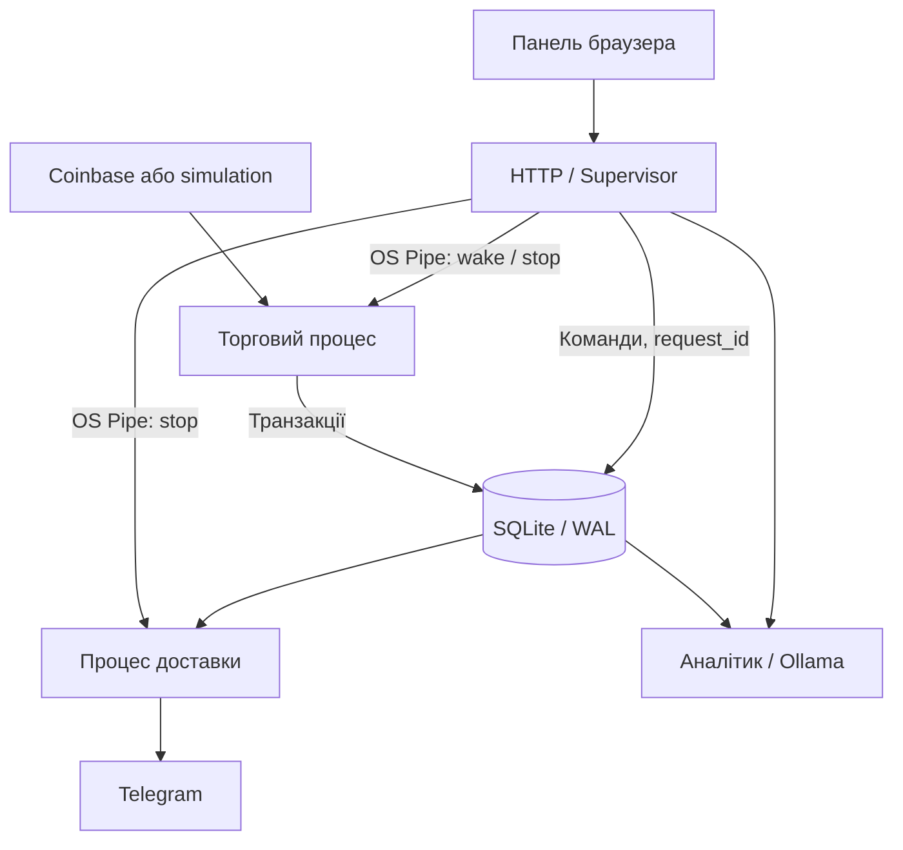
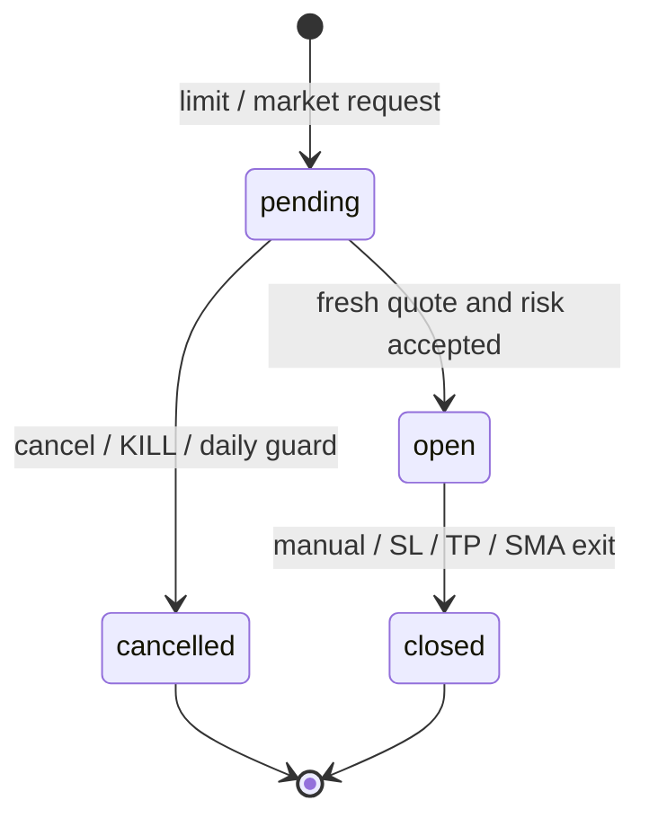

# ORBIT як проєкт із системного програмування

## Мета

Побудувати локальний агент, який працює незалежно від відкритої сторінки, отримує ринкові дані, перевіряє ризик, моделює виконання, записує результат транзакційно та відновлюється після аварійного завершення дочірнього процесу.

## Архітектура

| Системний механізм | Де | Що продемонструвати |
| --- | --- | --- |
| Створення процесів ОС | `runtime.Supervisor`, multiprocessing `spawn` | Різні PID для HTTP, engine та notifier |
| Міжпроцесна взаємодія | Односпрямовані `multiprocessing.Pipe` | `wake` прискорює обробку, `stop` завершує цикл |
| Довговічна черга | Таблиця `commands` | Після падіння незавершена команда знову доступна |
| Синхронізація | `BEGIN IMMEDIATE`, WAL, `busy_timeout` | Серіалізація записів, узгоджені знімки для UI |
| Ідемпотентність | UNIQUE `request_id`; перевірка payload | Подвійне надсилання створює один ордер |
| Атомарність | Ефект команди і її результат в одній транзакції; SAVEPOINT | Падіння до commit відкочує обидва |
| Файлове блокування | POSIX `flock` / Windows `msvcrt.locking` | Другий запуск тієї самої БД відхиляється |
| Сигнали ОС | SIGINT, SIGTERM у батьківському процесі | Коректне завершення, join; terminate / kill як запасний шлях |
| Відновлення | Перевірка exitcode дочірніх процесів | Після аварійного завершення PID змінюється, стан БД зберігається |
| Планування | `time.monotonic()` для циклу; UTC-ключ години для звітів | Стрибок системного годинника не задає інтервал polling |
| Звітність | UNIQUE bucket та outbox в одній транзакції | Перезапуск не створює другий локальний звіт тієї ж години |
| Грошовий облік | Decimal, значення TEXT | Комісії та резерви без двійкового float у балансах |

Pipe не переносить фінансові команди: у ньому тільки короткі сигнали. Самі команди й результати зберігаються у SQLite. Якщо повідомлення `wake` загубилось через падіння, новий процес однаково читає чергу. При рестарті створюється новий канал. Це також уникає блокування shared Event / Condition, чий lock може залишитися зайнятим після примусового завершення процесу.

SQLite має інших записувачів для черги HTTP, журналу діалогу та стану доставки. **Тільки торговий процес змінює ордери й кошти.** Транзакції короткі: мережеві звернення відбуваються до них. LLM працює в потоці HTTP, не в торговому процесі; notifier — в окремому процесі.

## Стан ордера

Market проходить `pending → open` в одній транзакції. Pending ордер резервує бюджет, не списуючи cash. Після fill budget списується; після close повертаються виручка мінус комісія. Equity = cash + оцінка відкритих позицій за останньою ціною з оцінкою витрат на вихід. Резерв є частиною cash, тому не додається до equity повторно.

## Сценарій захисту на 7–10 хвилин

1. **Постановка задачі.** Чому агент потребує фонового процесу та стійкого стану; що моделюється, а що поки не підключено.
2. **Запуск simulation.** Покажи маркування synthetic data, PID ядра, heartbeat і таблиці SQLite.
3. **Паперова угода.** Створи market на $250; покажи entry, SL, TP, резерви й cash. Створи limit по іншому активу та скасуй його.
4. **Дублювання команди.** Запусти тест ідемпотентності: два запити з одним request_id дають один ордер.
5. **Аварійна зупинка.** Активуй KILL, перезапусти застосунок; покажи збережене блокування. Зніми KILL вручну, залишивши автопілот на паузі.
6. **Відновлення.** Тест runtime завершує дочірній процес і перевіряє новий PID та незмінну кількість ордерів. Не завершуйте випадкові процеси ОС.
7. **Звіти.** Створи ручний звіт, покажи SQLite та outbox. Telegram демонструй лише зі своїм ботом і без показу токена.
8. **Межі.** Поясни, чому локальний stop не захищає при вимкненому комп’ютері і чому live execution вимагає reconciliation з біржею.

Команда перевірки: `python -m unittest discover -s tests -v`.

## Для дисципліни, де обов’язкові Arduino або C/C++

Уточни формальну вимогу викладача до платформи. Python multiprocess runtime демонструє системні механізми, але не є програмою Arduino.

Можливе розширення: перенести risk engine або IPC-сервіс у C++ / Rust із тим самим транзакційним контрактом. Якщо Arduino обов’язкова — окремий симульований контролер фізичної кнопки KILL та heartbeat через serial-протокол з sequence number, checksum, timeout і відхиленням дубльованих команд. **Цього контролера у поточній версії немає**; не заявляй його реалізованим на захисті.

## Обмеження гарантій

- Exactly-once стосується **локальної БД** за один request_id; не поширюється на Telegram або майбутні біржові запити.
- Supervisor перевіряє завершення, а не гарантовано виявляє зависання процесу. UI показує вік heartbeat.
- Немає hard real-time гарантій; інтервали залежать від мережі, навантаження та планувальника ОС.
- UTC-звіт унікальний за годину; пропущені під час простою години не відновлюються. Звіт, створений при старті, може ще не мати котирувань при відсутній мережі.
- Денна база — перша оцінка equity, коли процес працює в UTC-добі, а не гарантована ціна рівно опівночі. Блокування 3% не є гарантією максимальної втрати.
